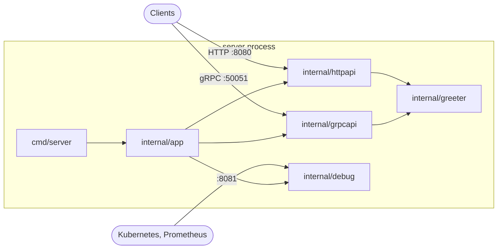

# Architecture

## Overview

One process runs three servers:

| Server | Default address | Audience | Contents |
|---|---|---|---|
| HTTP API | `:8080` | public | JSON endpoints under `/v1/` |
| gRPC API | `:50051` | public | services from `api/`, gRPC health, reflection |
| Debug | `:8081` | cluster-internal only | `/livez`, `/readyz`, `/metrics`, `/debug/pprof/`, `/debug/version` |

## Request flow

HTTP: `logRequests → instrument → recoverPanics → ServeMux → handler → business package`.

gRPC: `metrics → logging → recovery → service implementation → business package`.

Handlers translate between the wire format and business calls. Business
packages contain the rules and know nothing about transports, so the same
logic is reachable over HTTP and gRPC and tested without either.

## Lifecycle

1. `cmd/server` parses configuration (flags and env), builds the logger and
   subscribes to `SIGINT`/`SIGTERM`.
2. `app.New` constructs all dependencies and **binds all listeners**: a bad
   address or a busy port fails fast, before anything starts.
3. `App.Run` starts the servers in an `errgroup` and marks the service ready.
4. On a signal (or if any server fails), shutdown starts:
   readiness turns to 503 and gRPC health to `NOT_SERVING`, then the HTTP and
   gRPC servers drain in-flight requests within `SHUTDOWN_TIMEOUT`. The debug
   server stops last, so probes and metrics work while draining.
5. `Run` returns `nil` after a clean shutdown; `main` exits with code 1 on error.

Set the pod's `terminationGracePeriodSeconds` higher than `SHUTDOWN_TIMEOUT`.

## Observability

- **Logs**: `log/slog`, JSON in production, text locally (`LOG_FORMAT`).
  Every request is logged once, after it completes, with route and status.
- **Metrics**: one Prometheus registry per process (no global state), with Go
  runtime, process and build-info collectors,
  `http_server_request_duration_seconds{method,route,code}` and the
  `grpc_server_*` family. The `route` label is the ServeMux pattern, so
  cardinality stays bounded.
- **Profiling**: `go tool pprof http://localhost:8081/debug/pprof/profile`.
- **Build info**: `GET /debug/version`, `server --version`.

## Configuration

Declared once in `internal/config` as struct tags; each option is a flag and an
environment variable. `server --help` prints the reference; `.env.example`
lists the defaults.

## Code generation

`.proto` files in `api/` are the source of truth for the gRPC API.
`make generate` runs `buf generate` with `protoc-gen-go` (Opaque API) and
`protoc-gen-go-grpc`, all pinned in `tools/go.mod`. Generated files are
committed so the module builds with plain `go build`; CI fails if they are stale.
